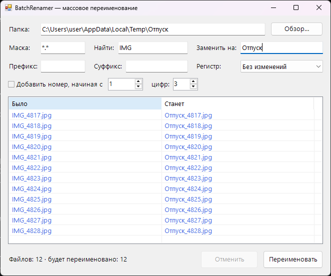

<div align="center">

# 📝 BatchRenamer

**Массовое переименование файлов с живым предпросмотром и отменой**




</div>

## ✨ Возможности

- 👁️ **Живой предпросмотр**: видно, как будет называться каждый файл, ещё до переименования
- 🔎 Найти и заменить (без учёта регистра)
- ➕ Префикс и суффикс
- 🔢 Нумерация: с какого числа начинать и сколько цифр (`_001`, `_002`, …)
- 🔠 Регистр: строчные, ЗАГЛАВНЫЕ, Каждое Слово
- 🗂️ Фильтр по маске (`*.jpg`, `IMG_*`, …)
- 🛡️ **Безопасно**:
  - конфликты имён и недопустимые символы подсвечиваются красным, и переименование блокируется
  - если в процессе что-то пошло не так, все изменения откатываются
  - кнопка «Отменить» возвращает прежние имена
- 🔁 Корректно обрабатывает обмен именами и смену только регистра (`photo.jpg` → `Photo.jpg`)

## 🚀 Запуск с папкой

```bat
BatchRenamer.exe "C:\Photos\Отпуск"
```

## 📥 Установка

1. Скачай `BatchRenamer.exe` из раздела [**Releases**](../../releases/latest)
2. Запусти его, установка не нужна

## 🛠️ Сборка из исходников

Нужен только Windows: компилятор C# входит в состав .NET Framework.

```bat
build.bat
```

## 📄 Лицензия

[MIT](LICENSE)
